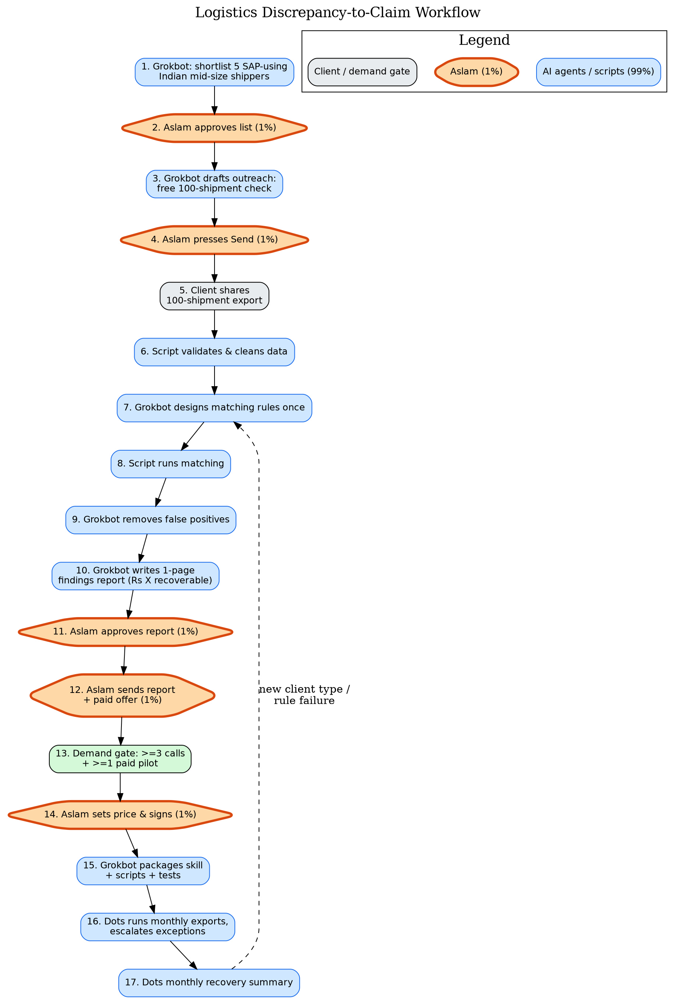

# Logistics Discrepancy-to-Claim Workflow



Diagram source: [`docs/workflow.mmd`](docs/workflow.mmd) (Mermaid) and [`docs/workflow.dot`](docs/workflow.dot) (Graphviz, used to render the PNG). Blue = AI agents/scripts (99%), orange = Aslam (1%).

## 1. What this is
We check a company's shipments (purchase orders, proof of delivery, freight invoices, e-way bills) and find money they are losing: overbilled freight, short deliveries, duplicate invoices and deductions nobody agreed to. We get paid a monthly fee or a share of the money recovered. The service is built on Aslam's expertise in SAP, logistics and AI.

## 2. The 99% / 1% rule
AI agents (Grokbots, ChatGPT Dots, Python scripts) do 99% of the work. Aslam does only the 1%:
- Approve the target list
- Approve each report before it goes out
- Press Send on outreach that goes out under his name
- Set the price and sign the deal

## 3. Step-by-step workflow
| Step | What happens | Who does it | Output |
|---|---|---|---|
| 1 | Target research: shortlist 5 SAP-using, high-shipping Indian mid-size firms, with evidence | Grokbot | Shortlist with evidence |
| 2 | Approve the target list **[1%]** | Aslam | Approved list |
| 3 | Draft personalised outreach offering a free 100-shipment check | Grokbot | Outreach drafts |
| 4 | Press Send **[1%]** | Aslam | Outreach sent |
| 5 | Client shares an export of 100 shipments (CSV/Excel) | Client | Raw data |
| 6 | Validate and clean the data | Script | Clean dataset |
| 7 | Design the matching rules once (quantity, rate, date, duplicates, deductions vs contract) | Grokbot | Rule set |
| 8 | Run matching on all shipments | Script | Flagged items |
| 9 | Review the flags and remove false positives | Grokbot | Verified discrepancies |
| 10 | Write a 1-page findings report (₹X recoverable, evidence for each item) | Grokbot | Findings report |
| 11 | Approve the report **[1%]** | Aslam | Approved report |
| 12 | Send the report with a paid offer **[1%]** | Aslam (presses Send) | Offer sent |
| 13 | Demand gate: each scoping call or paid yes counts toward the rule of ≥3 calls + ≥1 paid pilot | Grokbot tracks | Go/no-go |
| 14 | Set the price and sign **[1%]** | Aslam | Signed deal |
| 15 | Only after a paid yes: package the rules as a skill, scripts and tests in this repo | Grokbot | Reusable skill |
| 16 | Run each new monthly export through the skill, commit the report to the repo, escalate only exceptions | Dots | Monthly report |
| 17 | Produce a monthly recovery summary. Grokbot comes back only for new client types or rule failures | Dots (Grokbot if needed) | Recovery summary |

## 4. Guardrails
- No spending without Aslam's approval.
- No message is sent without Aslam.
- Client data is never committed to GitHub. Only anonymised samples go in the repo.
- No invented numbers. Every figure traces back to client data.

## 5. Status
Planning only. Nothing has been built yet.

## 6. Planned folder structure
```
docs/      workflow docs and diagram (exists)
skills/    packaged matching skill (planned)
scripts/   validation and matching scripts (planned)
tests/     rule tests (planned)
samples/   anonymised sample data only (planned)
```
